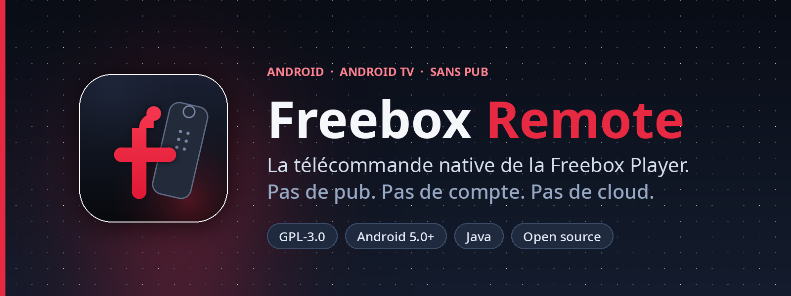
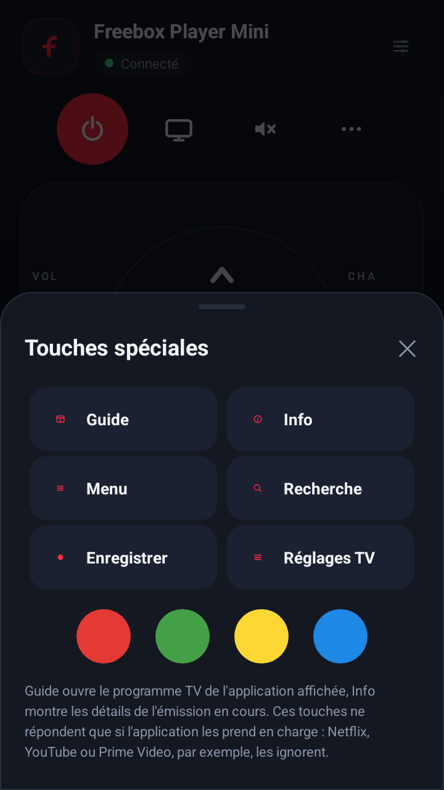

# Freebox Remote



[](LICENSE)
[](https://developer.android.com)
[](#pourquoi-cette-application)
[](https://github.com/cloestro/freebox-remote-android/releases/latest)

**La télécommande Android native de la Freebox Player.** Elle parle directement
au Player depuis le téléphone, en TLS, sur le réseau local. Aucun agent à
installer sur un PC, aucun compte, aucune publicité, aucune connexion à
Internet.

## Pourquoi cette application ?

Parce que j'en avais marre. Marre d'ouvrir une « télécommande Freebox » du Play
Store et de tomber sur un bandeau plein écran, une bannière clignotante, une
offre d'abonnement ou une demande de compte, avant même de pouvoir appuyer sur
« volume + ».

J'ai donc **vibe-codé** cette application : décrite à une IA, testée, corrigée,
puis redessinée jusqu'à obtenir quelque chose que j'ai plaisir à utiliser tous
les jours. Le résultat est une application Java de ~100 Ko, sans framework,
sans Gradle, sans dépendance externe, qui fait une seule chose : piloter la
Freebox Player.

Elle est publiée sous **GPL-3.0** pour rester libre : vous pouvez la lire, la
modifier, la redistribuer — et personne ne pourra en faire une version bourrée
de publicités sans publier son code.

## Aperçu

| Télécommande | Touches spéciales |
| --- | --- |
|  |  |

## Fonctionnalités

- **Télécommande complète** : navigation, OK, retour, accueil, menu, volume,
  chaînes, media (lecture, avance, retour rapide, stop, enregistrement).
- **Pavé directionnel circulaire** dessiné au Canvas : chevrons symétriques,
  OK centré, appui long avec répétition et glissement d'une direction à
  l'autre sans lever le doigt.
- **Clavier numérique** intégré et touches de couleur dans un dock dédié.
- **Touches spéciales** (Guide, Info, Menu, Recherche, Enregistrer, Réglages
  TV, couleurs) regroupées dans un panneau **⋯**.
- **Raccourcis d'applications** : YouTube, Netflix, Prime Video, Molotov,
  france.tv, Twitch.
- **Appairage intégré** : découverte réseau, code hexadécimal saisi sur un
  pavé maison, certificat client mémorisé.
- **Reconnexion automatique**, état de la connexion en direct, vibration
  légère, écran maintenu allumé.
- **Interface en français**, thème sombre, aucune police d'emoji : toutes les
  icônes sont vectorielles.
- **Zéro traqueur, zéro permission réseau superflue** : le Player est joint en
  direct sur le LAN.

## Installation

Télécharger le dernier APK depuis les
[**Releases GitHub**](https://github.com/cloestro/freebox-remote-android/releases/latest)
(`FreeboxRemote.apk`), puis l'ouvrir sur le téléphone. Android demandera
d'autoriser l'installation depuis l'application utilisée (Fichiers, Chrome…) :
**Paramètres → Applications → Accès spéciaux → Installer des applis inconnues**.
Play Protect peut afficher un avertissement (APK signé hors Play Store) :
choisir **Installer quand même**.

Ou en ligne de commande :

```bash
adb install -r FreeboxRemote.apk
```

> Les versions publiées ici sont signées avec la même clé de développement :
> les mises à jour s'installent **par-dessus** l'ancienne version, sans
> désinstaller ni réappairer le Player.

Prérequis : **Android 5.0 (API 21)** ou plus récent, et le téléphone sur le
même réseau local que le Player.

## Premier lancement

1. Toucher **Rechercher mon Player**. L'application scanne le réseau local et
   liste les Players trouvés (nom et adresse MAC lus dans leur certificat).
   Si le Player n'apparaît pas, saisir son **adresse IPv4** puis **OK**.
2. Toucher le Player dans la liste : le panneau **Appairage** s'ouvre.
3. Sur la TV, un code à **6 caractères hexadécimaux** s'affiche (`0`–`9`,
   `A`–`F`). Le saisir avec le pavé intégré, puis **Valider le code**.
4. C'est prêt : la télécommande apparaît et se reconnecte seule ensuite.

Le certificat client est stocké dans le stockage privé de l'application
(`client.p12`). Supprimer les données de l'app (ou changer de téléphone)
impose un nouvel appairage.

### À quoi servent Guide et Info ?

- **Guide** (`KEYCODE_GUIDE`, 172) demande à l'application affichée à la TV
  d'ouvrir sa grille des programmes.
- **Info** (`KEYCODE_INFO`, 165) demande les détails de l'émission en cours.

Ces touches sont **définies par Android TV, mais chaque application décide de
les traiter**. L'application TV de la Freebox les gère ; Netflix, YouTube,
Prime Video ou Twitch les ignorent le plus souvent — ce n'est pas un défaut de
la télécommande. Un rappel de cette limite est affiché dans le panneau **⋯**.

## Limites connues

- Le Player doit être allumé et joignable sur le réseau local. En veille, la
  télécommande peut le réveiller ; s'il est débranché, l'app affiche
  « Hors ligne » et réessaie.
- L'application utilise le protocole **Android TV Remote v2** (TLS + secret
  d'appairage), le seul exposé par la Freebox Player. Elle ne passe pas par
  l'API HTTP de la Freebox Server.
- Les raccourcis d'applications dépendent de ce qui est installé sur le
  Player : si une application manque, le Player peut ouvrir le Play Store ou
  ne rien faire.
- Pas de clavier texte complet ni de commande vocale : le Player n'expose pas
  ces fonctions par ce protocole.
- Certains routeurs activent l'**isolation des clients Wi-Fi** : téléphone et
  TV ne peuvent alors pas se joindre. Désactiver cette option, ou utiliser le
  même réseau.

## Confidentialité

- Toutes les communications restent sur le **réseau local**, en TLS
  (ports 6466 et 6467 du Player).
- Le certificat client est auto-signé, sa clé privée reste dans le stockage
  privé de l'application. Le certificat du Player est accepté sans autorité de
  certification : la confiance repose sur l'appairage initial (code affiché
  sur la TV).
- Aucune télémétrie, aucun compte, aucune publicité, aucun accès Internet.

## Reconstruire l'APK

Le projet n'utilise **ni Gradle ni Kotlin** : uniquement du Java et les outils
du SDK Android. Le script compile les ressources avec `aapt2`, compile le Java
avec `javac --release 8`, produit le dex avec `d8`, aligne avec `zipalign` et
signe avec `apksigner`.

Prérequis : **JDK 17 ou 21**, `curl`, `unzip`, `zip`.

```bash
# avec un SDK déjà présent
ANDROID_SDK_ROOT=/chemin/vers/android-sdk ./build.sh

# ou : le script télécharge le SDK dans ./.android-sdk
./build.sh
```

L'APK est généré à la racine : `FreeboxRemote.apk`.

> `build.sh` crée une clé locale `.debug.keystore` si elle est absente. Une
> reconstruction personnelle produit donc une signature différente de celle
> des Releases : désinstaller l'ancienne version avant d'installer la vôtre.

## Sous le capot

| Fichier | Rôle |
| --- | --- |
| `MainActivity.java` | Interface complète : installation, appairage, télécommande, panneaux |
| `PairingClient.java` | Appairage TLS sur le port 6467, code hexadécimal, secret SHA-256 |
| `RemoteClient.java` | Session de télécommande sur le port 6466, touches, pings, reconnexion |
| `ClientCert.java` | Certificat client PKCS#12 et contexte TLS |
| `Der.java` | Encodage X.509 DER sans dépendance |
| `Proto.java` | Encodage/décodage protobuf minimal |
| `Frames.java` | Frames longueur + protobuf |
| `Discovery.java` | Scan du /24 et lecture du nom/MAC dans le certificat |
| `CertInfo.java` | Extraction du nom et de la MAC du certificat du Player |
| `KeyCodes.java` | Codes de touches Android TV |
| `Apps.java` | Liens des applications |
| `DpadView.java` | Pavé directionnel circulaire dessiné au Canvas |
| `IconView.java` | Icônes vectorielles dessinées au Canvas (aucun fichier image) |
| `build.sh` | Compilation et signature de l'APK sans Gradle |

## Notes de version

- **1.4** — Refonte visuelle : fond en dégradé, en-tête avec tuile logo « f »,
  pastille d'état, boutons circulaires à icônes dessinées, carte centrale et
  dock flottant. Pavé directionnel entièrement redessiné (chevrons symétriques,
  OK parfaitement centré, appui long et glissement). Les touches **Guide**,
  **Info**, **Menu**, **Recherche**, **Enregistrer**, **Réglages TV** et les
  couleurs sont regroupées dans le panneau **⋯**. Nouvelle icône : télécommande
  en filigrane et « f » Freebox, déclinée en PNG, icône adaptative et variante
  monochrome (Android 13+).
- **1.3** — Corrige le plantage au premier appui après l'appairage : les
  messages ne sont plus écrits dans la connexion TLS depuis le thread
  d'interface. Les touches passent par une file d'envoi dédiée, ordre conservé.
- **1.2** — Corrige l'écran de télécommande vide après appairage et la
  fermeture de l'application via **✕** / **Annuler** / **Recommencer**.
- **1.1** — Pavé hexadécimal intégré pour le code d'appairage (0–9, A–F), sans
  clavier système.
- **1.0** — Première version : découverte réseau, appairage, télécommande
  complète, clavier numérique, couleurs, liens d'applications, reconnexion.

## Licence

Distribué sous **GNU General Public License v3.0** — voir [LICENSE](LICENSE).

Ce programme est un logiciel libre : vous pouvez le redistribuer et/ou le
modifier selon les termes de la GPL v3. Il est fourni **sans aucune garantie**.

Le fait que le code ait été écrit avec l'aide d'une IA ne change rien aux
termes de la licence : c'est le code distribué qui est couvert, pas la manière
dont il a été produit.

---

Projet non officiel, sans affiliation avec Free, Freebox ou Android TV.
« Freebox » est une marque de Free SAS.
