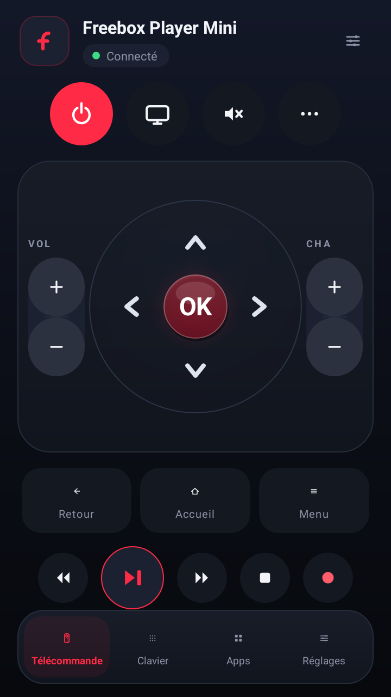

# Freebox Remote


[](LICENSE)
[](https://developer.android.com)
[](#contexte-et-motivations)
[](https://github.com/cloestro/freebox-remote-android/releases/latest)

Application Android native de télécommande pour la **Freebox Player**. Elle
communique directement avec le Player depuis le téléphone, en TLS, sur le
réseau local : aucun agent installé sur un ordinateur, aucun compte requis,
aucune publicité et aucune connexion à Internet.

## Contexte et motivations

Le projet est né d'un constat : les applications de télécommande Freebox
disponibles sur le Play Store intègrent fréquemment des publicités, des offres
d'abonnement ou des demandes de création de compte, y compris avant l'accès
aux commandes essentielles telles que le réglage du volume.

L'application a été développée selon une approche de **vibe coding**, avec
l'assistance d'un assistant IA pour la conception, l'implémentation, les tests
et les itérations de l'interface. Le résultat est une application Java d'environ
100 Ko, sans framework, sans Gradle et sans dépendance externe, dédiée à une
seule fonction : piloter la Freebox Player.

La publication sous **GPL-3.0** garantit le caractère libre du logiciel : le
code peut être consulté, modifié et redistribué, et toute redistribution doit
conserver ces libertés.

## Aperçu

| Télécommande | Touches spéciales |
| --- | --- |
|  |  |

## Fonctionnalités

- **Télécommande complète** : navigation, OK, retour, accueil, menu, volume,
  chaînes, commandes multimédia (lecture, avance, retour rapide, arrêt,
  enregistrement).
- **Pavé directionnel circulaire** dessiné au Canvas : chevrons symétriques,
  touche OK centrée, appui long avec répétition et glissement d'une direction
  à l'autre sans lever le doigt.
- **Clavier numérique** intégré et touches de couleur dans un dock dédié.
- **Touches spéciales** (Guide, Info, Menu, Recherche, Enregistrer, Réglages
  TV, couleurs) regroupées dans un panneau **⋯**.
- **Raccourcis d'applications** : YouTube, Netflix, Prime Video, Molotov,
  france.tv, Twitch.
- **Appairage intégré** : découverte réseau, saisie du code hexadécimal sur un
  pavé dédié, mémorisation du certificat client.
- **Reconnexion automatique**, état de la connexion affiché en temps réel,
  retour par vibration et maintien de l'écran allumé.
- **Interface en français**, thème sombre, icônes vectorielles sans recours à
  une police d'emoji.
- **Aucun traqueur ni authentification** : le Player est joint directement sur
  le réseau local, sans permission réseau superflue.

## Installation

Télécharger le dernier APK depuis les
[**Releases GitHub**](https://github.com/cloestro/freebox-remote-android/releases/latest)
(`FreeboxRemote.apk`), puis l'ouvrir sur le téléphone. Android demandera
d'autoriser l'installation depuis l'application utilisée (Fichiers, Chrome…) :
**Paramètres → Applications → Accès spéciaux → Installer des applis inconnues**.
Play Protect peut afficher un avertissement, l'APK étant signé hors Play Store :
choisir **Installer quand même**.

Installation en ligne de commande :

```bash
adb install -r FreeboxRemote.apk
```

> Les versions publiées dans ce dépôt sont signées avec la même clé : les
> mises à jour s'installent **par-dessus** l'ancienne version, sans
> désinstallation ni nouvel appairage du Player.

Prérequis : **Android 5.0 (API 21)** ou plus récent, et le téléphone connecté
au même réseau local que le Player.

## Configuration initiale

1. Toucher **Rechercher mon Player**. L'application analyse le réseau local et
   liste les Players détectés (nom et adresse MAC lus dans leur certificat).
   Si le Player n'apparaît pas, saisir son **adresse IPv4** puis **OK**.
2. Sélectionner le Player dans la liste : le panneau **Appairage** s'ouvre.
3. Sur la TV, un code à **6 caractères hexadécimaux** s'affiche (`0`–`9`,
   `A`–`F`). Le saisir avec le pavé intégré, puis toucher **Valider le code**.
4. La télécommande s'affiche ensuite. Les connexions ultérieures sont
   automatiques.

Le certificat client est stocké dans le stockage privé de l'application
(`client.p12`). La suppression des données de l'application ou le remplacement
du téléphone impose un nouvel appairage.

### Prise en charge des touches Guide et Info

- **Guide** (`KEYCODE_GUIDE`, 172) demande à l'application affichée sur la TV
  d'ouvrir sa grille des programmes.
- **Info** (`KEYCODE_INFO`, 165) demande l'affichage des détails de l'émission
  en cours.

Ces touches sont **définies par Android TV, mais leur traitement dépend de
chaque application**. L'application TV de la Freebox les prend en charge ;
Netflix, YouTube, Prime Video ou Twitch les ignorent généralement. Cette limite
est rappelée dans le panneau **⋯**.

## Limites connues

- Le Player doit être allumé et joignable sur le réseau local. En veille, la
  télécommande peut le réveiller ; s'il est débranché, l'application affiche
  « Hors ligne » et réessaie périodiquement.
- L'application utilise le protocole **Android TV Remote v2** (TLS + secret
  d'appairage), seul protocole exposé par la Freebox Player. Elle ne passe pas
  par l'API HTTP de la Freebox Server.
- Les raccourcis d'applications dépendent des applications installées sur le
  Player : si une application est absente, le Player peut ouvrir le Play Store
  ou ne rien faire.
- Le clavier texte intégral et la commande vocale ne sont pas disponibles : le
  Player n'expose pas ces fonctions via ce protocole.
- Certains routeurs activent l'**isolation des clients Wi-Fi**, qui empêche le
  téléphone et la TV de communiquer. Désactiver cette option ou utiliser le
  même réseau.

## Confidentialité et sécurité

- Toutes les communications restent sur le **réseau local**, en TLS (ports 6466
  et 6467 du Player).
- Le certificat client est auto-signé et sa clé privée reste dans le stockage
  privé de l'application. Le certificat du Player est accepté sans autorité de
  certification : la confiance repose sur l'appairage initial (code affiché sur
  la TV).
- Aucune télémétrie, aucun compte, aucune publicité et aucun accès Internet ne
  sont nécessaires.

## Reconstruire l'APK

Le projet n'utilise **ni Gradle ni Kotlin** : uniquement du Java et les outils
du SDK Android. Le script compile les ressources avec `aapt2`, compile le Java
avec `javac --release 8`, produit le dex avec `d8`, aligne l'archive avec
`zipalign` et la signe avec `apksigner`.

Prérequis : **JDK 17 ou 21**, `curl`, `unzip`, `zip`.

```bash
# avec un SDK déjà présent
ANDROID_SDK_ROOT=/chemin/vers/android-sdk ./build.sh

# sinon, le script télécharge le SDK dans ./.android-sdk
./build.sh
```

L'APK est généré à la racine : `FreeboxRemote.apk`.

> `build.sh` crée une clé locale `.debug.keystore` si elle est absente. Une
> reconstruction locale produit donc une signature différente de celle des
> Releases : désinstaller la version installée avant d'installer votre build.

## Structure du projet

| Fichier | Rôle |
| --- | --- |
| `MainActivity.java` | Interface complète : installation, appairage, télécommande, panneaux |
| `PairingClient.java` | Appairage TLS sur le port 6467, code hexadécimal, secret SHA-256 |
| `RemoteClient.java` | Session de télécommande sur le port 6466, touches, pings, reconnexion |
| `ClientCert.java` | Certificat client PKCS#12 et contexte TLS |
| `Der.java` | Encodage X.509 DER sans dépendance |
| `Proto.java` | Encodage/décodage protobuf minimal |
| `Frames.java` | Frames longueur + protobuf |
| `Discovery.java` | Analyse du /24 et lecture du nom/MAC dans le certificat |
| `CertInfo.java` | Extraction du nom et de la MAC du certificat du Player |
| `KeyCodes.java` | Codes de touches Android TV |
| `Apps.java` | Liens des applications |
| `DpadView.java` | Pavé directionnel circulaire dessiné au Canvas |
| `IconView.java` | Icônes vectorielles dessinées au Canvas (aucun fichier image) |
| `build.sh` | Compilation et signature de l'APK sans Gradle |

## Historique des versions

- **1.4** — Refonte visuelle : fond en dégradé, en-tête avec tuile logo « f »,
  pastille d'état, boutons circulaires à icônes dessinées, carte centrale et
  dock flottant. Pavé directionnel entièrement redessiné (chevrons symétriques,
  touche OK centrée, appui long et glissement). Les touches **Guide**, **Info**,
  **Menu**, **Recherche**, **Enregistrer**, **Réglages TV** et les couleurs sont
  regroupées dans le panneau **⋯**. Nouvelle icône : télécommande en filigrane
  et « f » Freebox, déclinée en PNG, en icône adaptative et en variante
  monochrome (Android 13+).
- **1.3** — Correction du plantage survenant au premier appui après l'appairage
  : les messages ne sont plus écrits dans la connexion TLS depuis le thread
  d'interface. Les touches passent par une file d'envoi dédiée, ordre conservé.
- **1.2** — Correction de l'affichage vide de la télécommande après appairage
  et de la fermeture de l'application via **✕** / **Annuler** /
  **Recommencer**.
- **1.1** — Pavé hexadécimal intégré pour le code d'appairage (0–9, A–F), sans
  clavier système.
- **1.0** — Première version : découverte réseau, appairage, télécommande
  complète, clavier numérique, couleurs, liens d'applications, reconnexion
  automatique.

## Licence

Distribué sous **GNU General Public License v3.0** — voir [LICENSE](LICENSE).

Ce programme est un logiciel libre : il peut être redistribué et/ou modifié
selon les termes de la GPL v3, et est fourni **sans aucune garantie**.

Le recours à un assistant IA pour l'écriture du code ne modifie pas les termes
de la licence : c'est le code distribué qui est couvert, et non sa méthode de
production.

---

Projet non officiel, sans affiliation avec Free, Freebox ou Android TV.
« Freebox » est une marque de Free SAS.
